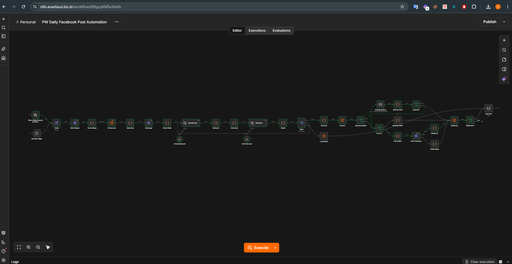

# PlacidWay Daily Facebook Post Automation (n8n)

**Demo recording:** `https://drive.google.com/file/d/1llokBUNMnWyxRSCho7bGpyn_bLDdDS7W/view?usp=sharing`
**Workflow files:** [`workflow/placidway-daily-fb-post.json`](workflow/placidway-daily-fb-post.json), [`workflow/placidway-error-alert.json`](workflow/placidway-error-alert.json)
**Sample outputs:** [`samples/sample-posts.md`](samples/sample-posts.md)

An n8n workflow that turns public PlacidWay pages into one on-brand Facebook post per day. It extracts a fresh page, never repeats a URL, writes the post with an LLM, checks it with two guardrail layers, and then publishes it to a test Page or sends it to a human for approval first. Every run is logged, and failures send an alert instead of failing silently.

> **Ground rules followed:** only public PlacidWay pages are used, `robots.txt` is respected, there are at most 2 requests per run (far below 1 request per second), and posts go only to a Facebook test Page that I own. Nothing is ever posted to a PlacidWay page.



---

## Contents

1. [How it works](#how-it-works)
2. [Setup](#setup)
3. [Configuration reference](#configuration-reference)
4. [How to run](#how-to-run)
5. [The run log](#the-run-log)
6. [Design decisions and trade-offs](#design-decisions-and-trade-offs)
7. [Testing the failure paths](#testing-the-failure-paths)
8. [Known limitations and next steps](#known-limitations-and-next-steps)
9. [Security notes](#security-notes)
10. [Troubleshooting](#troubleshooting)
11. [AI assistance](#ai-assistance)

---

## How it works

```
Schedule Trigger (daily) ─┐
                          ├─► Config
Manual Trigger ───────────┘      │
                                 ▼
  Fetch sitemap ─► Parse sitemap (newest N by lastmod) ─► Get log rows ─► Select item
                                                                              │
  Fetch page ─► Extract fields (title, summary, image, body) ◄────────────────┘
        │
        ▼
  Generate post (LLM, JSON only) ─► Build post ─► Rule check ─► Verify post (2nd LLM) ─► Decide ─► Route
                    ▲                                                                              │
                    └──────────────────────────── retry (violations as feedback, max 3) ◄─────────┤
                                                                                                   │
        blocked ─► Log blocked ─► Send alert ◄─────────────────────────────────────────────────────┤
                                                                                                   │
        pass ─► Final post ─► Log start (status: pending) ─► Approval needed?                      │
                    yes ─► Request approval (email) ─► Approval result ─► Approved?                │
                                  no / expired ─► Update log                                       │
                    no, or approved ─► Dry run?                                                    │
                                  yes ─► Simulate publish ─► Update log                            │
                                  no  ─► Plan publish ─► Post to Facebook                          │
                                              ok ─► Publish OK ─► Update log                       │
                                              error ─► Publish failed ─► Update log                │
                                                                                                   │
        Update log ─► Needs alert? (failed / expired) ─► Send alert

Separate workflow: Error Trigger ─► Log error ─► Send error alert   (site down, no items, crashes)
```

### What each stage does

| Stage | Nodes | What happens |
|---|---|---|
| Trigger | `Schedule Trigger`, `Manual Trigger` | Runs once a day, and can be run by hand for testing |
| Settings | `Config` | Every flag and setting is in this one node |
| Extract | `Fetch sitemap`, `Parse sitemap`, `Fetch page`, `Extract fields` | Downloads one sitemap, keeps the newest pages, fetches the chosen page, reads title, summary, image and body |
| Select | `Get log rows`, `Select item` | Skips any URL already `posted`, `pending` or `scheduled`, then picks one |
| Generate | `Generate post`, `Build post` | The LLM returns JSON (hook, lines, CTA, hashtags). Code assembles the final post with the real link |
| Guardrails | `Rule check`, `Verify post`, `Decide`, `Route` | Deterministic rules, then a second LLM check. Fail means retry with feedback, and blocked after the last attempt |
| Review | `Request approval`, `Approval result`, `Approved?` | Optional. A human approves or rejects by email before anything is published |
| Publish | `Dry run?`, `Plan publish`, `Post to Facebook`, `Publish OK`, `Publish failed` | Simulates, or calls the Facebook Graph API (photo post, or text with link preview, or a scheduled post) |
| Log and alert | `Log start`, `Update log`, `Log blocked`, `Needs alert?`, `Send alert` | Records every run and emails on failure |

---

## Setup

### Requirements

- Docker (to run n8n)
- An LLM API key (any chat model supported by n8n)
- A Facebook **test Page** that you own, and a Meta developer app
- An SMTP account for approval and alert emails (for example Gmail with an app password, or a Mailtrap sandbox inbox)

### 1. Start n8n

```bash
docker compose up -d
```

Open http://localhost:5678 and create the owner account. Set the workflow timezone (workflow menu, Settings, Timezone) so the daily schedule fires when you expect.

The included `docker-compose.yml` sets `GENERIC_TIMEZONE` and `TZ`. For approval links that work from other devices, also set the public address variables shown in the comments of that file:

```yaml
- WEBHOOK_URL=https://your-domain.example/
- N8N_HOST=your-domain.example
- N8N_PROTOCOL=https
- N8N_PROXY_HOPS=1
```

Approval emails are built from `WEBHOOK_URL`. If it is not set, links may point to `localhost` and only work on the machine running n8n. Your domain must also reach n8n (for example through a Cloudflare Tunnel or a reverse proxy).

### 2. Create the `run_log` Data table

In n8n open **Overview, Data tables, Create**. Name it `run_log` and add these columns, all of type **String**:

`run_id`, `url`, `content_type`, `title`, `post_text`, `image_url`, `fb_post_id`, `mode`, `status`, `error`

### 3. Import the workflows

For each file in `workflow/`: create a new workflow, open the **...** menu, choose **Import from File**, and select the file. Credentials are never included in an export, so n8n will show warnings on nodes that need them. In every Data table node, re-select your `run_log` table.

### 4. Create credentials

Open **Overview, Credentials, Create**.

| Credential | Type | Used by |
|---|---|---|
| `FB Page Token` | **Query Auth**. Name: `access_token`. Value: your long-lived **Page** access token | `Post to Facebook` |
| LLM credential | The chat model credential for your provider | `Generate post`, `Verify post` |
| SMTP | **SMTP** | `Request approval`, `Send alert`, error workflow email |

**Getting the Facebook Page token**

1. Create a Facebook Page you own, and a Meta developer app (keep it in Development mode).
2. In Graph API Explorer, generate a **User token** with `pages_show_list`, `pages_read_engagement` and `pages_manage_posts`, and select your test Page when asked.
3. Exchange it for a long-lived user token (`oauth/access_token` with `grant_type=fb_exchange_token`).
4. Call `GET /me/accounts` with that token. The `access_token` shown for your Page is the long-lived **Page** token. Check it in the Access Token Debugger (it should show no expiry).
5. Store it in the `FB Page Token` credential. Never paste it into a node or commit it.

### 5. Edit `Config`

Set at least `facebook_page_id`, `reviewer_email` and `alert_email` (see the [reference](#configuration-reference)).

### 6. Connect the error workflow and activate

1. Edit the recipient in the error workflow's email node.
2. In the main workflow, open **... Settings** and set **Error Workflow** to `PlacidWay Error Alert`.
3. Switch the main workflow to **Active** so the Schedule Trigger runs daily.

---

## Configuration reference

Everything is in the `Config` node, so behavior changes never require editing code. The export ships with safe defaults: nothing is published until `dry_run` is switched off.

### Finding pages

| Field | Default | Meaning |
|---|---|---|
| `sitemap_url` | weekday expression | The one sitemap file downloaded each run (see [rotation](#content-rotation)) |
| `content_type` | weekday expression | Label for the type of page (`article`, `answer` or `news`), stored in the log. Must follow the same weekday list as `sitemap_url` |
| `candidates` | `100` | How many of the newest sitemap entries to keep before dedupe |
| `user_agent` | `PWAssessmentBot/1.0` | Sent with every request so the site can identify the client |

### Writing the post

| Field | Default | Meaning |
|---|---|---|
| `max_chars` | `500` | Limit for the text before the link |
| `max_attempts` | `3` | Generation attempts when the guardrails reject a post. After the last attempt the post is blocked |

### Posting

| Field | Default | Meaning |
|---|---|---|
| `dry_run` | `true` | `true` = no Facebook call. The run is logged as `simulated` with a fake post ID |
| `approval_mode` | `false` | `true` = the draft is emailed to the reviewer, and publishing waits for Approve (or Disapprove) |
| `schedule_minutes` | `0` | `0` = publish now. Above 0 = schedule that many minutes ahead (minimum 11; Facebook accepts 10 minutes to 30 days) |
| `facebook_page_id` | your Page ID | The test Page that receives posts |
| `fb_api_version` | `v26.0` | Graph API version used in the request URL |

### Emails

| Field | Default | Meaning |
|---|---|---|
| `reviewer_email` | `reviewer@example.com` | Receives approval requests |
| `alert_email` | `reviewer@example.com` | Receives failure alerts |

### Test helpers

| Field | Default | Meaning |
|---|---|---|
| `pick_index` | `0` | Pick the Nth unposted page instead of the newest. Used to collect samples |
| `test_force_violation` | `false` | Injects a bad sentence on attempt 1 to demonstrate the guardrails and the retry loop |

### Content rotation

To keep the feed varied, the content type rotates by weekday (Monday = 1 ... Sunday = 7):

| Day | Content type | Sitemap |
|---|---|---|
| Mon, Wed, Fri, Sun | Blog articles | `https://www.placidway.com/1/sitemap_articles.xml` |
| Tue, Sat | Patient Q&A | `https://www.placidway.com/sitemap/1/sitemap_answers.xml` |
| Thu | News | `https://www.placidway.com/1/sitemap_news.xml` |

Both `content_type` and `sitemap_url` read the same weekday list so they always agree:

```
['article','answer','article','news','article','answer','article'][$now.weekday - 1]
```

To force a type while testing, replace the expressions with fixed values. Package, doctor and testimonial pages are deliberately skipped because they invite price and outcome claims.

---

## How to run

- **Manual run:** open the workflow and click **Execute workflow**. A manual run uses the content type of the current weekday.
- **Daily run:** activate the workflow. The Schedule Trigger fires once a day at the configured time.
- **Approval mode:** set `approval_mode` to `true`. Approve or reject from the email. The link works on any device when `WEBHOOK_URL` is public. If nobody responds within 24 hours the run ends as `expired` and an alert is sent.
- **Scheduling instead of posting now:** set `schedule_minutes` above 0 (with `dry_run` off). The run ends as `scheduled` and the post appears under the Page's scheduled posts.

---

## The run log

`run_log` is the store of what was posted and the history of every run. One row per run.

| Status | Meaning | Blocks that URL from being picked again? |
|---|---|---|
| `pending` | Passed the guardrails, waiting for approval or publishing | Yes |
| `posted` | Published to Facebook (post ID saved) | Yes |
| `scheduled` | Scheduled on Facebook | Yes |
| `simulated` | Dry run, nothing sent to Facebook | No |
| `rejected` | The reviewer disapproved | No |
| `expired` | No approval response in time (alert sent) | No |
| `failed` | Publishing or another step failed (alert sent) | No |
| `blocked` | The guardrails rejected every attempt (alert sent) | No |

Because only `posted`, `pending` and `scheduled` use up a URL, test runs can be repeated freely.

---

## Design decisions and trade-offs

### Extraction: sitemaps, one fetch per page, Open Graph tags

- PlacidWay has **no RSS feed**, and `robots.txt` disallows `/api/v1/`, so there is no API to use.
- The site publishes a **sitemap index** with child sitemaps per content type, each with `lastmod` dates. These are the site's own list of crawlable pages.
- Pages are **server-rendered** and carry `og:title`, `og:description` and `og:image`, so no headless browser is needed. The image is already a 1200x630 CDN URL suited to Facebook.
- A run makes **two requests** (one sitemap, one page), well under the 1 request per second limit. An identifying User-Agent is sent.
- `lastmod` means last modified, not first published, so "newest" means recently updated.
- **Trade-off:** if PlacidWay changes its templates or moves to client-side rendering, the parser needs updating. Different content types also have different layouts, so extraction is verified per type.

### Selection and duplicate protection

Selection takes the newest candidates and skips any URL whose `run_log` status is `posted`, `pending` or `scheduled`. A `pending` row is written **before** approval or publishing, so a paused approval cannot let the next run pick the same page.

### Generation

The LLM must return JSON only (hook, 2 to 4 lines, CTA, 3 to 5 hashtags). **Code assembles the final post**, so the link is always the real URL and the structure never depends on the model. The text before the link is kept under 500 characters.

### Guardrails: two layers, fail closed

The post must not make medical claims or promise outcomes, invent prices, or state facts that are not on the source page.

1. **Rule check (deterministic):**
   - Format: length limit, 2 to 4 value lines, 3 to 5 hashtags, a hook and a CTA, and the source URL exactly once.
   - Language: blocks cure, heal, reverse, restore and guarantee wording; hype such as miracle, risk-free and painless; superlatives; safety and efficacy claims; price, currency and savings language.
   - Grounding: every number in the post must appear in the source text.
2. **LLM verifier:** a second call (temperature 0) compares the post with the source page and flags unsupported facts, medical claims, outcome promises, prices and superlatives.

If either layer fails, the violations are sent back to the generator as feedback and it tries again, up to `max_attempts`. After that the post is **blocked**, logged and alerted. If the verifier's output cannot be parsed, the post counts as failed (**fail closed**).

PlacidWay pages themselves contain prices and efficacy language, so these claims are blocked **even when the source page states them**. Describing what a page covers ("compares", "explains") is allowed, and stating what a treatment achieves is not.

### Publishing

- Pages with an image are posted as a **photo with the text as caption**. Posts without an image, and scheduled posts, use the **feed endpoint** and Facebook builds the link preview.
- `dry_run` skips the API call and logs `simulated`.
- Approval uses n8n's **Send and Wait for Response** (email). The workflow pauses until Approve or Disapprove, or until the 24-hour limit.

### Errors, retries and alerts

- Web and LLM nodes **retry 3 times** with a short wait.
- Facebook failures are handled **inside the flow** through the node's error output. A token problem (error code 190) gets a specific message: "FACEBOOK TOKEN EXPIRED OR INVALID - refresh the Page token". The run is logged as `failed` and an alert is sent.
- Anything else (site down, no unposted items left, an unexpected crash) goes to the **error workflow**, which logs a `failed` row and emails an alert.
- Alerts are sent for `failed`, `expired` and `blocked`. A `rejected` post is a normal human decision, so it does not alert.

---

## Testing the failure paths

| To demonstrate | Do this | Expected |
|---|---|---|
| Guardrails and retry | `test_force_violation` = `true`, `dry_run` = `true` | Attempt 1 fails with violations, attempt 2 passes. Compare runs with the "Run 1 of 2" selector on `Decide` |
| Blocked + alert | `test_force_violation` = `true`, `max_attempts` = `1` | `blocked` row and alert email |
| Token failure | Select a credential with a wrong token in `Post to Facebook`, `dry_run` = `false` | `failed` row, alert with the token message |
| Approval | `approval_mode` = `true`, `dry_run` = `true`, click Approve or Disapprove | `simulated` or `rejected` row. No response gives `expired` |
| Site down | Set `sitemap_url` to a wrong address, run on the schedule | Error workflow email and a `failed` row |
| Collecting samples | `pick_index` = 0, 1, 2 ... with `dry_run` = `true` | A different page each run |

The error workflow only fires for automatic (scheduled) executions, not manual ones.

---

## Known limitations and next steps

- **Guardrail coverage.** Rules miss paraphrased claims, and the LLM verifier is non-deterministic and may share the generator's blind spots. Next: a labeled set of risky pages run as a regression test, and a different model family for verification.
- **Retries.** n8n's built-in retry does not separate permanent errors (bad token, 404) from transient ones, and a retried POST could double-post if the first call succeeded but its response was lost. The `pending` row limits the damage. A stronger version would check the Page's recent posts before retrying.
- **Concurrency.** Two runs starting at the same moment could pick the same URL. Next: a run lock or a unique constraint on the URL.
- **Prompt injection.** Page text is untrusted input to the LLM. Mitigations: the model has no tools and returns JSON only, the link and hashtags are assembled in code, rules and a second model check the output, and approval mode adds a human.
- **Engagement read-back** (reactions, clicks) is not implemented. Reading the Page feed returned a permissions error in my setup, so I left it out of scope.
- **Content types.** Only articles, Q&A and news are used. Packages and treatment pages would need stricter price handling.
- **Storage.** `run_log` is an n8n Data table. A production version would use an external database and a dashboard.

---

## Security notes

- Tokens and passwords live in n8n credentials. They are **not** in the exported workflow JSON. Search the export before sharing it.
- The Facebook token is a Page token for a **test Page only**. Revoke it (Facebook Settings, Business Integrations) or regenerate it when the project ends.
- Approval links contain a signature. Do not paste a full link in public places.
- If n8n is exposed on a public address, use a strong owner password and stop the tunnel or public hostname when it is no longer needed.

---

## Troubleshooting

| Problem | Likely cause and fix |
|---|---|
| Nodes show missing credentials after import | Expected. Credentials are not exported. Create them and select them in each node |
| `Get log rows` stops the workflow on the first run | Turn on **Always Output Data** for that node (and **Execute Once**) |
| `Sitemap returned no URLs` | Wrong `sitemap_url`, or the site returned an error page. Check the address |
| Approval email links point to `localhost` or `0.0.0.0` | `WEBHOOK_URL` is not set. Set it, recreate the container, and send a new request |
| `No unposted items left among the newest N` | Every candidate is already posted. Increase `candidates` or wait for new content |
| Facebook error 190 | The Page token is invalid or expired. Create a new long-lived Page token |
| Facebook error 10 or 200 | A missing permission. Regenerate the token with all three Page permissions |
| A row stays `pending` | A run stopped before `Update log`. Delete that row so the URL can be used again |

---

## AI assistance

I used an AI assistant to draft node configuration, code and documentation. I tested each node's output myself, along with the retry loop, the token-failure path and the approval flow, and I can explain every part of the workflow.

---

## Repository layout

```
.
├── README.md
├── docker-compose.yml
├── .gitignore
├── workflow/
│   ├── README.md                       (how to export and import)
│   ├── placidway-daily-fb-post.json
│   └── placidway-error-alert.json
├── code/                               (every Code node, one file per node)
├── prompts/                            (LLM prompts and the Config expressions)
├── samples/
│   └── sample-posts.md
└── docs/
    └── workflow-canvas.png
```

The code and prompts are also inside the workflow JSON. They are repeated in `code/` and `prompts/` so they can be read without importing anything.
